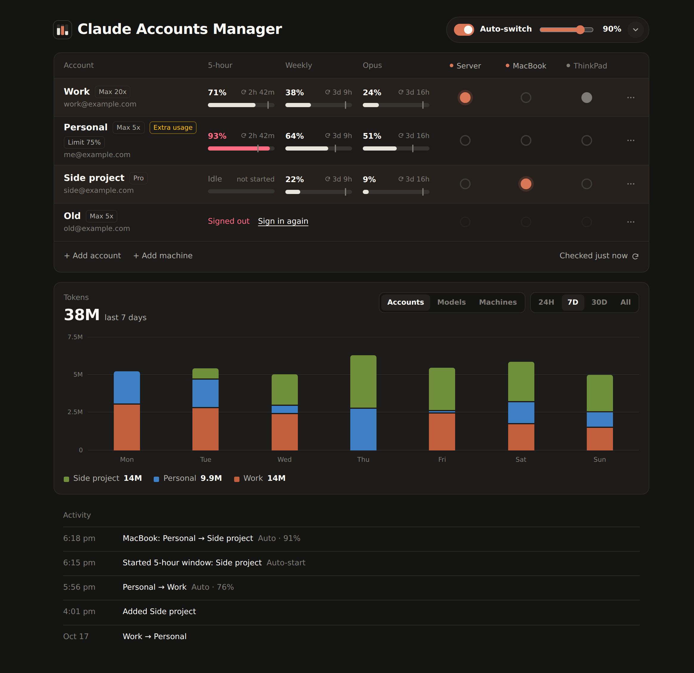

# Claude Accounts Manager

Switch Claude Code between your Claude subscriptions with one tap, on every machine you use, and see how much of each account's limits is left.



If you have more than one Claude subscription, you know the routine. An account hits its 5-hour limit, you SSH in, run `/login` and go through the browser flow. This app does it from a web page, on your phone if you like, for each of your machines, and can switch on its own before you hit the limit.

## Features

- Save all your Claude logins (Pro, Max, Team). Sign in to each one once.
- See 5-hour, weekly and per-model usage for every account, with time left until reset.
- Switch accounts with one click. Running Claude Code sessions continue on the new account, no restart.
- Use the same accounts on all your machines (macOS, Linux, Windows), each switched on its own, from one dashboard.
- Auto-switch when the active account reaches a limit you set, globally or per account.
- Auto-start idle accounts' 5-hour windows so they reset sooner.
- Token usage chart per account, model or machine.
- Warnings when something would bypass your subscription, such as an API key in the environment or extra usage turned on.

## Install

The app runs on Linux or WSL with Node.js 20+ and Claude Code. No npm dependencies. To use your accounts on a Mac or a Windows PC too, add it as another machine (below).

```sh
git clone https://github.com/Shivam29k/claude-accounts-manager.git
cd claude-accounts-manager
npm start
```

Open http://127.0.0.1:4330. The account Claude Code is signed in with shows up right away.

To keep it running in the background (it has to, for auto-switch), use the systemd user service in `deploy/`:

```sh
mkdir -p ~/.config/systemd/user
cp deploy/claude-accounts-manager.service ~/.config/systemd/user/
# set the node and checkout paths in ExecStart first
systemctl --user daemon-reload
systemctl --user enable --now claude-accounts-manager
loginctl enable-linger "$USER"
```

## Use it from your phone

The app only listens on 127.0.0.1. Put it on your [Tailscale](https://tailscale.com) network:

```sh
sudo tailscale serve --bg --https=10001 http://127.0.0.1:4330
```

Then open `https://<machine>.<tailnet>.ts.net:10001` and add it to your home screen. To change the `<machine>` part, rename the machine with `sudo tailscale set --hostname=<name>` and run the `tailscale serve` command again, since Tailscale keeps serve settings per name. Set `CAM_ALLOWED_LOGINS` to your Tailscale login so nobody else on your tailnet can use it. Never expose it to the public internet. Whoever can open the page can switch your accounts.

## Add an account

1. Click **+ Add account**, then **Sign in with Claude**. Use **Copy link** to open it in a private window or another browser.
2. Sign in with the account you want to add and approve. If claude.ai is already signed in as someone else, use a private window.
3. Paste the code Claude shows and click **Add account**.

## More machines

Run the app on one always-on machine (the hub), then add your other machines to it. They need Node.js 20+, Claude Code, and to be on the same tailnet.

1. Click **Add machine** and copy the command (macOS/Linux or Windows).
2. Run it on the other machine. It downloads a small agent from the hub, pairs with a one-time code and installs itself as a background service (systemd, launchd or a logon task).
3. The machine gets its own column in the accounts table. A filled dot marks the account it uses; click another dot in its column to move it. Click the machine's name for its details, to rename or to remove it.

Whatever account the machine was signed in to is kept: it's added to the hub if it's new. Before changing a machine's login, the agent saves the previous one in `~/.claude-accounts-agent/backups`. Each machine auto-switches on its own, preferring accounts no other machine is using, since machines on one account share its limits. To stop, run `node ~/.claude-accounts-agent/agent.mjs uninstall` there.

## Good to know

- **Switching** is one click on the dot in an account's row. **Auto-switch options** are behind the arrow next to the slider: which limits count, and whether to go to the account with the most room or the next one in your list. Drag rows to reorder.
- **Per-account settings** live in each row's ⋯ menu: a custom limit, skipping the account in auto-switch, auto-start, sign in again, remove.
- **Auto-start** sends `hi` on Haiku through the Claude Code CLI, using only that account's token. It costs a few tokens and leaves your live login alone. At most once per 15 minutes per account.
- **The token chart** counts input, output and cache-write tokens from Claude Code's transcripts on every machine. Usage from before a machine was added shows as "Other" in the Accounts view.
- **A session didn't switch?** It's probably using an API key or another config directory. The app lists those at the top of the page.
- **Sign-in rate-limited?** Wait for the countdown, then try once with a fresh link. Retrying sooner can extend the block.

## Configuration

Environment variables. Everything else is set in the UI.

| Variable | Default | |
| --- | --- | --- |
| `CAM_PORT` | `4330` | Port |
| `CAM_HOST` | `127.0.0.1` | Address to listen on |
| `CAM_ALLOWED_LOGINS` | | Tailscale logins allowed in, comma-separated |
| `CAM_DATA_DIR` | `~/.claude-accounts-manager` | Saved accounts and backups |
| `CAM_CLAUDE_DIR` | `~/.claude` | Claude Code's config directory |
| `CAM_CLAUDE_BIN` | `claude` on `PATH` | Claude Code executable |

## How it works

Claude Code on Linux keeps its login in `~/.claude/.credentials.json`, and running sessions reload that file when it changes. The app keeps each account's tokens, refreshes them, and on a switch writes the chosen account's login into that file and `~/.claude.json`, leaving everything else in them as it was. Sign-in uses the same OAuth flow as `claude /login`, and usage comes from the endpoint behind Claude Code's `/usage`.

Other machines get access tokens only. The hub keeps every refresh token and renews logins well before they expire, so no machine can refresh a shared login behind another's back (refresh tokens are single-use). The agent writes the login where Claude Code reads it: the Keychain on macOS, `.credentials.json` elsewhere. It long-polls the hub, so a switch lands within seconds, and running sessions pick it up by themselves.

## Security

Saved logins are OAuth tokens stored in `~/.claude-accounts-manager/state.json` (mode 600), the same way Claude Code stores its own on Linux. The page never receives tokens, and the API rejects requests from other websites. Each machine authenticates with its own token (only a hash is stored on the hub); removing the machine in the dashboard locks its agent out.

## Contributing

`npm test` runs the test suite. It needs no network and doesn't touch your Claude files.

## Disclaimer

Not affiliated with Anthropic. This relies on the same undocumented endpoints as Claude Code, so a Claude Code update can break it. Make sure your use of multiple subscriptions follows Anthropic's terms.

## License

MIT
