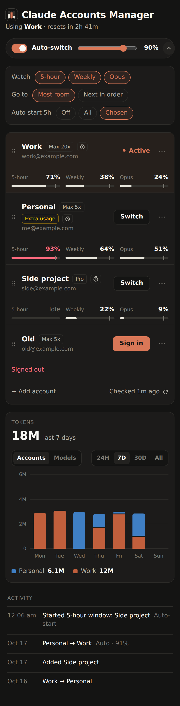
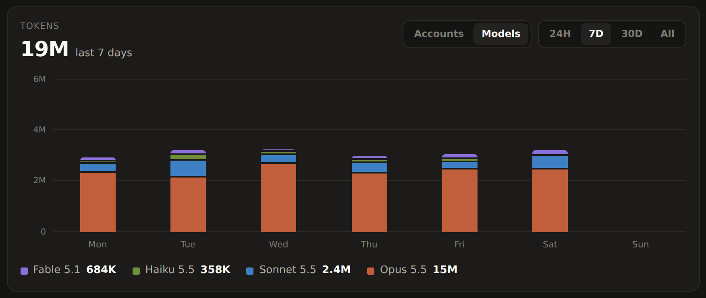
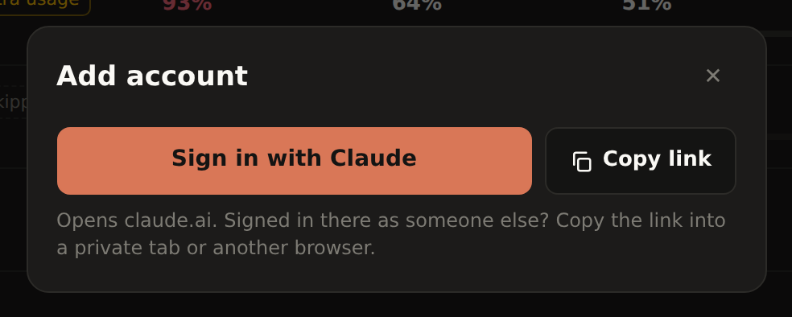

# Claude Accounts Manager

A small web app for a machine that runs Claude Code. It keeps several Claude subscription logins, shows how much of each account's usage limits is left, and switches the account Claude Code uses with one click. It can also switch for you when the active account gets close to a limit.


I run Claude Code on a server and have more than one Claude subscription. Every time an account hit its 5-hour limit I had to SSH in, run `/login` and go through the browser flow again. Now I open this page on my phone, tap Switch, and every running Claude Code session continues on the other account. With auto-switch on, I don't even do that.

## What it does

- Saves any number of Claude logins (Pro, Max, Team) and keeps their tokens refreshed, so you sign in to each account once.
- Shows each account's 5-hour session, weekly and per-model limits, with reset times, read from the same endpoint as Claude Code's `/usage`.
- Switches Claude Code to another account. Sessions that are already running pick up the new login on their next request, without a restart.
- Auto-switch: when the active account reaches a threshold you set (90% by default), it moves Claude Code to the account with the most room left, or to the next one in your order.
- Can start idle accounts' 5-hour windows for you by sending them a one-word message, so their limits reset sooner. You choose which accounts.
- Charts token usage from Claude Code's transcripts, per account or per model, for the last 24 hours, 7 days, 30 days or all time.
- Warns about anything that would bypass your subscriptions, such as an `ANTHROPIC_API_KEY` in a running Claude process, an `apiKeyHelper`, or extra usage (pay-as-you-go) being enabled on an account.
- Works on a phone. Rows reorder by drag and drop, and names change on double-click or double-tap.

<p>
  
  
</p>

## How it works

Claude Code on Linux keeps its login in `~/.claude/.credentials.json` (the `claudeAiOauth` key) and the account profile in `~/.claude.json` (`oauthAccount`). The app stores a copy of those entries for every account you add. A switch writes the target account's entries into both files and leaves everything else in them alone, including MCP server tokens and project settings.

Before using its token, a running Claude Code process checks the credentials file's modification time and reloads the file if it changed. That is why a switch reaches sessions that are already open, including ones started by IDE extensions or tools built on the Claude Agent SDK.

Claude Code refreshes the active account's token on its own, and refresh tokens are single-use. Before every switch the app reads the live file and saves the newest tokens of the outgoing account, so neither side ends up holding a dead refresh token. It refreshes tokens of idle accounts itself, one request at a time per account, and copies the credentials file to `backups/` before overwriting it.

New accounts sign in through the same OAuth flow as `claude /login`, with the same client, scopes and PKCE. Its token requests copy the headers Claude Code's own requests carry. That matters because Anthropic's token endpoint answered 429 to requests that looked different.

Usage numbers come from `GET https://api.anthropic.com/api/oauth/usage`. The active account is checked every 2 minutes, every minute once it is within 15 points of the threshold, and the others every 10 minutes.

Token counts come from the transcripts Claude Code writes to `~/.claude/projects/`. The app reads each file once, then only the new lines, and counts every message once even though Claude Code writes it several times. It counts input, output and cache-write tokens. Cache reads are about 40 times larger and mostly re-read the same context, so the chart leaves them out. Transcripts don't record which account sent a message, so the app keeps a timeline of which account was active when and attributes tokens by time. Usage from before you installed the app shows up as "Other".

## Requirements

- Linux or WSL, where Claude Code stores its login in `~/.claude/.credentials.json`. On macOS Claude Code keeps the login in the Keychain, which this app doesn't support.
- Node.js 20 or newer. There are no npm dependencies.
- Claude Code itself. The app reads the installed version to match its request headers, and falls back to known values if it can't find `claude`.

## Quick start

```sh
git clone https://github.com/Shivam29k/claude-accounts-manager.git
cd claude-accounts-manager
npm start
```

Open http://127.0.0.1:4330. If Claude Code is already signed in, that account appears in the list right away. Add the others with **+ Add account**.

## Run it as a service

The app needs to keep running to refresh tokens and switch automatically. A systemd user service template is in `deploy/`:

```sh
mkdir -p ~/.config/systemd/user
cp deploy/claude-accounts-manager.service ~/.config/systemd/user/
# Edit ExecStart: the absolute path to node (`which node`) and to server.mjs.
systemctl --user daemon-reload
systemctl --user enable --now claude-accounts-manager
loginctl enable-linger "$USER"   # keep it running after you log out
journalctl --user -u claude-accounts-manager -f
```

## Open it from your phone with Tailscale

The app listens on 127.0.0.1 only. To reach it from your other devices, put it on your tailnet with `tailscale serve`, which adds HTTPS and keeps it private to your tailnet:

```sh
sudo tailscale serve --bg --https=10001 http://127.0.0.1:4330
```

Then open `https://<machine>.<tailnet>.ts.net:10001` on your phone. Set `CAM_ALLOWED_LOGINS` to your Tailscale login so that only you can use it. `tailscale serve` adds a `Tailscale-User-Login` header to every request, and the app rejects requests without a listed login. Don't use `tailscale funnel` or any other way of putting this on the public internet. Anyone who can open the page can switch your accounts.

## Adding an account

1. Click **+ Add account**, then **Sign in with Claude**. To use a different browser or device, or a private window, click **Copy link** and open the link there.
2. Sign in to claude.ai with the account you want to add and approve access. If the browser is already signed in to claude.ai as another account, use a private window, otherwise you'll approve the wrong one.
3. Claude shows a code. Paste it into the box and click **Add account**.



A link stays valid for 30 minutes, also across restarts of the app. If you ran `claude /login` in a terminal instead, the app notices the new login and offers to save it.

If Claude answers a sign-in with a rate-limit error, the app stops sending attempts for 5 minutes, doubling up to 30 for repeated errors. Retrying during a block seems to extend it. Wait for the countdown, then use a fresh link once.

## Auto-switch

Open the options with the arrow next to the auto-switch slider.

- **Watch** chooses which limits count: the 5-hour session, the weekly limit, and per-model weekly limits such as Opus.
- **Go to** chooses where to switch: the account with the most room left, or the next account in the list order. Drag rows to change the order.
- Accounts marked "Skip in auto-switch" (in the row's ⋯ menu) are never picked automatically.
- After an automatic switch the app waits at least 3 minutes before switching again.
- If every account is past the threshold, it stays put and says so.

## Auto-start 5-hour windows

An account's 5-hour window starts with its first message and resets 5 hours later. While an account sits unused, no window is running. When you finally switch to it, its window only starts then, and so only resets 5 hours later. With auto-start on, the app sends "hi" from idle accounts so their windows start right away and have reset, or nearly, by the time you need them. When a window ends and nothing starts a new one, the next check starts it again, so windows run back to back.

Choose **Auto-start 5h** in the options row: Off, All, or Chosen. With Chosen, turn it on for an account in that row's ⋯ menu. Accounts with it on show an "Auto-start" tag, and the 5-hour column says "Idle" while no window is running.

The message goes through the real Claude Code CLI: `claude -p hi --model haiku --tools "" --no-session-persistence`, with the account's token in `CLAUDE_CODE_OAUTH_TOKEN` and its own empty config directory (`$CAM_DATA_DIR/warmup`). It costs a few Haiku tokens, doesn't touch the login Claude Code is using, and doesn't load your settings, hooks or plugins. The app messages an account at most once every 15 minutes and logs each message under Activity.

## Configuration

All settings are environment variables.

| Variable | Default | Meaning |
| --- | --- | --- |
| `CAM_HOST` | `127.0.0.1` | Address to listen on |
| `CAM_PORT` | `4330` | Port to listen on |
| `CAM_DATA_DIR` | `~/.claude-accounts-manager` | Where saved accounts, the token index and backups live |
| `CAM_ALLOWED_LOGINS` | empty | Comma-separated Tailscale logins allowed to use the UI. Empty allows anyone who can reach the port |
| `CAM_CLAUDE_DIR` | `$CLAUDE_CONFIG_DIR` or `~/.claude` | Claude Code's config directory, which holds `.credentials.json` and `projects/` |
| `CAM_CLAUDE_JSON` | `~/.claude.json` | Claude Code's global config file |
| `CAM_CLAUDE_BIN` | `claude` on `PATH`, else `~/.local/bin/claude` | The Claude Code executable. Used to read its version and to send auto-start messages |

Threshold, watched limits, switch strategy, auto-start and check intervals are set in the UI and saved with the accounts.

## Security

- Saved logins are OAuth tokens in plain JSON at `$CAM_DATA_DIR/state.json`, with mode 600 in a mode 700 directory. That is the same protection Claude Code gives its own credentials file on Linux. Anyone who can read the file can use your subscriptions.
- The server listens on 127.0.0.1 by default. The API never returns tokens.
- Every POST must carry an `X-CAM: 1` header. Browsers can't add that header to a cross-site request without a CORS preflight, and the server doesn't answer preflights, so other websites can't drive the API through your browser.
- The server only serves a fixed list of files from `public/`.

## Troubleshooting

**A session didn't move to the new account.** It probably isn't using the subscription login. A Claude process started with `ANTHROPIC_API_KEY`, `ANTHROPIC_AUTH_TOKEN` or `CLAUDE_CODE_OAUTH_TOKEN` in its environment ignores the credentials file, and one with a different `CLAUDE_CONFIG_DIR` reads another file. The app lists these at the top of the page.

**An account says "Signed out".** Claude rejected its refresh token, which happens after a password change, a logout from all devices, or long inactivity. Click **Sign in** on that row.

**Usage shows "rate-limited".** The usage endpoint limits how often it can be read. The app backs off for at least 5 minutes and tries again.

**Times look wrong.** The page shows times in the time zone of the device you're viewing it on.

## Development

```sh
npm test
```

The tests use Node's built-in test runner. They run the real manager, token index and HTTP server against temporary directories and a fake Anthropic client, so they need no network and don't touch your Claude files.

```
server.mjs            entry point: wires the parts together and starts the loops
src/config.mjs        environment variables
src/anthropic.mjs     OAuth and API calls, shaped like Claude Code's
src/claude-files.mjs  reading and writing Claude Code's credentials and config
src/manager.mjs       accounts, token refresh, usage checks, switching, sign-in
src/store.mjs         state.json: accounts, settings, activity, timeline
src/tokens.mjs        token usage index built from Claude Code transcripts
src/usage.mjs         turns the usage API answer into meters
src/health.mjs        warnings about logins that bypass the subscription
src/warmup.mjs        auto-start: sends "hi" through the Claude Code CLI as one account
src/http.mjs          HTTP server and API routes
public/               the page (plain HTML, CSS and JavaScript modules)
test/                 unit and integration tests
```

## Disclaimer

This is an independent project, not affiliated with or endorsed by Anthropic. It uses the same undocumented endpoints as Claude Code, which can change with any Claude Code release. If something breaks after an update, the request details in `src/anthropic.mjs` are the first place to look. You are responsible for making sure the way you use your Claude subscriptions follows Anthropic's terms.

## License

MIT
